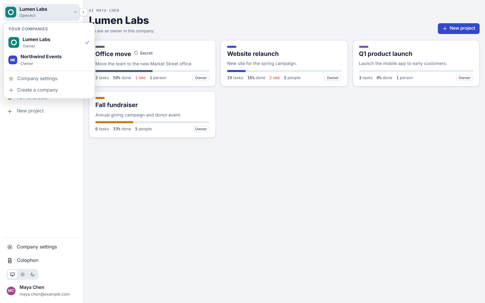
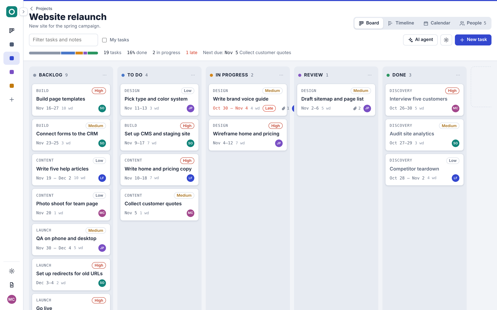
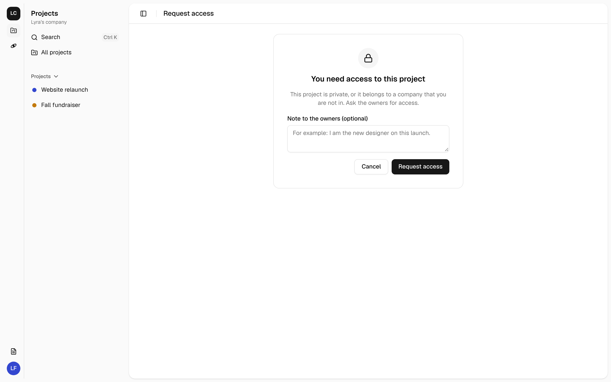
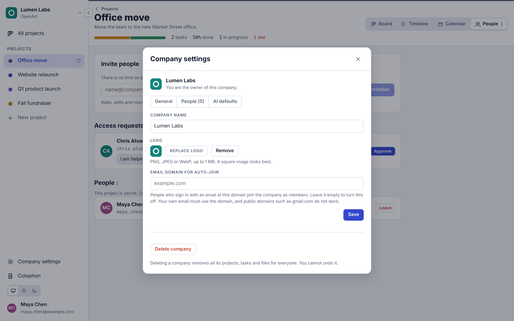
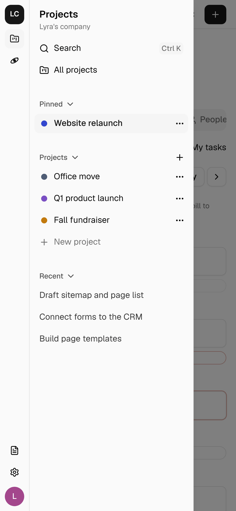

# OpenAct

OpenAct is a light project management tool with a Kanban board, a Gantt timeline and a calendar. It runs on Cloudflare Workers, D1 and R2. MarketGrowth makes it and shares it as open source under the MIT license.

[](https://deploy.workers.cloudflare.com/?url=https://github.com/marketgrowth/openact)


## Features

- **Companies (multi-tenant).** One install holds many companies. Switch between them from the menu at the top of the side panel. Each company has its own projects, people, logo, email domain and AI defaults. Anyone signed in can create a company.
- **Secret projects and access requests.** Company members see every company project. Owners can make a project secret, so only invited people see it. Anyone who opens a link to a project they cannot see can ask for access, and the owners approve or decline.
- **A collapsible side panel.** The company switcher, the company's projects and your settings. Collapse it to icons, or open it as a drawer on a phone.
- **Many projects.** Each project has its own board, timeline, people and files.
- **Unlimited people.** There are no seat limits. Invite anyone by email.
- **Kanban board with your own columns.** Add, rename, reorder and delete columns per project. Each column says what it means (not started, in progress, in review or done), so progress and late checks keep working. Drag cards between columns.
- **Gantt timeline.** Drag a bar to move a task. Drag an edge to change its length. Tasks group by phase, with a summary bar for each phase. The header shows days or ISO weeks, and a line marks today.
- **Calendar.** A month view. Each task shows as a card on its start date and as a deadline pill on its end date. Click either to open the task in the side drawer. Drag a card to move the task, or drag a pill to change the deadline. Phones get an agenda list.
- **Roles.** In a project, owners manage people and settings, editors change tasks, and viewers only look. In a company, owners and admins manage the company, members see company projects, and guests see only the projects they are invited to.
- **Sign-in without passwords.** People type their email and get a 6-digit code. [Resend](https://resend.com) sends the email.
- **File attachments.** Attach files up to 25 MB to a task. Files go to R2.
- **AI agent with role-based access.** Tell the agent what to do in plain words: "Move the late tasks to next week" or "Rename Review to QA". The agent acts for you and never has more power than your role. Owners choose how much each role may hand to the agent. Deletes, people changes and large batches wait for your approval, and every agent action is logged. Read [docs/AGUI.md](docs/AGUI.md).
- **Search by words and by meaning.** Press Ctrl+K or Cmd+K to search every project you can see in the company. Search finds "Book the gala hall" when you type "venue". It uses [Vectorize](https://developers.cloudflare.com/vectorize/) and Workers AI embeddings, and falls back to words only when Vectorize is not set up. The task drawer shows related tasks, and the agent can search big projects.
- **Clickable links.** Web addresses in a project description or in task notes show as links that open in a new tab. OpenAct never fetches them. Only `http` and `https` links work.
- **Note search, when owners allow it.** Owners can let the agent search task notes, for example for a contact or a location. The agent gets only a short part of each matching note, with email addresses and phone numbers hidden. The filter box on the board also searches notes.
- **The agent stays on topic.** A quick check reads each new request first. With a TypeSafe key, [Jev](https://typesafe.ai/) answers typed questions about the request, and code makes the decision. A request for another project gets a link that opens it there. New work gets an offer to start a project for it. Anything else gets a short decline and does not use the main AI model.
- **AI tools.** Draft tasks from a goal, or write a status summary. All AI requests go through [Cloudflare AI Gateway](https://developers.cloudflare.com/ai-gateway/). Workers AI is the default, so you need no extra API key. Anthropic and OpenAI are optional.
- **Built on AG-UI.** The agent speaks [AG-UI](https://docs.ag-ui.com). Approvals use AG-UI interrupts, so any AG-UI client can connect.
- **Themes.** Light, dark, or follow the system setting.
- **Live updates.** When someone changes a project, every open page updates at once, including changes made by the AI agent. The header shows who else is viewing. Each project has a Durable Object that holds its WebSockets, and idle connections hibernate, so they cost almost nothing. If live updates are not available, pages check for changes every 5 seconds.

## Screenshots

The screenshots use example data: a sample team and projects.

| | |
| --- | --- |
|  |  |
| **Company switcher.** Change company from the top of the side panel. | **Projects.** The current company's projects. Secret ones show a shield. |
|  |  |
| **Timeline.** Drag bars to move tasks. Phases have summary bars. | **Calendar.** Cards show starts. Pills show deadlines. |
|  |  |
| **Task drawer.** Edit details and attach files. | **Collapsed panel.** Icons only, for more room. |
|  |  |
| **People.** Invite by email, and approve access requests. | **Request access.** The page never shows the project's name. |
|  |  |
| **Company settings.** Name, logo, auto-join domain, people and AI defaults. | **Sign-in.** An email code. No password. |
|  |  |
| **Dark theme.** Or follow the system setting. | **Dark calendar.** |

<p align="center"> &nbsp; </p>
<p align="center"><b>Phones.</b> The calendar becomes an agenda list, and the side panel becomes a drawer.</p>

## Companies and access

Every project belongs to one company. A person can be in many companies and switch between them at the top of the side panel.

| Company role | What they can do |
| --- | --- |
| Owner | Manage the company, its people, its owners and every company project. Delete the company. |
| Admin | Manage the company, its people and every company project. |
| Member | See every company project as a viewer. Create projects. |
| Guest | See only the projects they are invited to. |

| Project visibility | Who can see it |
| --- | --- |
| Company | Every company member, as a viewer. Company owners and admins manage it. People on the project keep their project role. |
| Secret | Only the people on the project. Company owners and admins do not see it unless they are on it. |

- **Invite to the company** from **Company settings > People**. People join as members or admins.
- **Invite to one project** from that project's **People** tab. Someone from outside the company joins as a guest and sees only that project.
- **Email domain auto-join.** Set a domain such as `acme.com` in **Company settings**. People who sign in with that domain join as members. Public domains such as gmail.com are refused, your own email must use the domain, and each domain belongs to one company.
- **Request access.** A person who opens a project link without access sees a request form. The project owners get an email and approve (with a role) or decline in the **People** tab. Approving someone from outside the company makes them a guest. The page never shows the project's name.
- **AI defaults.** Company owners and admins set the AI access, note search and topic scope that new projects start with.
- **Removing someone from a company** removes them from all its projects.
- **Upgrading an older install.** Migration `0003_companies.sql` gives each project owner a company that holds their projects. Everyone else becomes a guest, so nobody can see more than before. Make people members in **Company settings** when you are ready.
- The AI agent only routes requests to projects in the same company.

## Deploy with one click

1. Click **Deploy to Cloudflare** above.
2. Sign in to Cloudflare. Connect GitHub or GitLab. Cloudflare copies this repository to your account.
3. Cloudflare creates the D1 database, the R2 bucket and the Vectorize index for you.
4. Fill in the form:
   - `RESEND_API_KEY`: your [Resend API key](https://resend.com/api-keys).
   - `AUTH_SECRET`: a long random string. Make one with `openssl rand -hex 32`.
   - `EMAIL_FROM`: the sender, for example `OpenAct <no-reply@yourdomain.com>`.
5. Click **Deploy**. The deploy script applies the database migrations, then deploys the Worker.

After the first deploy:

1. In Resend, verify the domain that you use in `EMAIL_FROM`. Without this step, sign-in emails do not arrive.
2. In the Cloudflare dashboard, go to **AI > AI Gateway** and make a gateway named `openact`. If the gateway does not exist, AI requests still work, but without gateway logs and limits.
3. Open your Worker URL. Type your email. The first person can always sign up.
4. Search by meaning needs a Vectorize index with 768 dimensions and a `project_id` metadata index. If search shows "Search by words" only, run `npm run search:setup` once from a copy of the repository. Search by words works without it.

## Deploy by hand

You need Node.js 20 or later and a Cloudflare account.

```sh
git clone https://github.com/marketgrowth/openact.git
cd openact
npm install
npx wrangler login

# Make the database. Copy the database_id from the output into wrangler.jsonc, under d1_databases.
npx wrangler d1 create openact

# Make the file bucket.
npx wrangler r2 bucket create openact-files

# Make the search index (768 dimensions, cosine, with a project_id metadata index).
npm run search:setup

# Add the secrets.
npx wrangler secret put RESEND_API_KEY
npx wrangler secret put AUTH_SECRET

# Set EMAIL_FROM and the other settings in wrangler.jsonc under "vars". Then build and deploy.
npm run build
npm run deploy
```

`npm run deploy` applies new migrations, checks the search index, then deploys. Use it for every update.

## Run it on your computer

```sh
npm install
cp .dev.vars.example .dev.vars   # optional
npm run dev
```

Open http://localhost:8787.

- Without `RESEND_API_KEY`, OpenAct does not send email. It prints each sign-in code in the terminal.
- `npm run dev` runs fully local, so AI assist and search by meaning are off. Search by words still works. To use AI on your computer, run `npx wrangler login`, then `npm run dev:ai`.
- For hot reload of the web app, run `npx wrangler dev --local` in one terminal and `npm run dev:ui` in a second terminal. Then open http://localhost:5173.

Other commands:

| Command | What it does |
| --- | --- |
| `npm run typecheck` | Checks the types of the Worker and the web app |
| `npm test` | Runs the unit tests |
| `npm run test:search` | Runs the search pipeline test: real migrations in SQLite, with fake Vectorize and Workers AI |
| `npm run search:setup` | Creates the Vectorize index and its metadata index. Safe to run again. |
| `npm run build` | Builds the web app into `dist/client` |
| `npm run db:migrate:local` | Applies migrations to the local database |
| `npm run db:migrate:remote` | Applies migrations to the Cloudflare database |

## Settings

Set these under `vars` in `wrangler.jsonc`, or in the Cloudflare dashboard.

| Name | Default | What it does |
| --- | --- | --- |
| `APP_NAME` | `OpenAct` | The name in the app and in emails |
| `APP_URL` | empty | The public URL used in email links. Empty means the URL of the request. |
| `EMAIL_FROM` | `OpenAct <no-reply@example.com>` | The sender address. The domain must be verified in Resend. |
| `SIGNUP_MODE` | `open` | `open`: anyone can sign up. `invite`: only invited people can sign up. |
| `ALLOWED_EMAIL_DOMAINS` | empty | A comma-separated list of domains that can sign up, for example `example.com,example.org` |
| `AI_PROVIDER` | `workers-ai` | `workers-ai`, `anthropic` or `openai` |
| `AI_MODEL` | `@cf/meta/llama-3.3-70b-instruct-fp8-fast` | The model ID for the provider |
| `AI_EMBED_MODEL` | `@cf/baai/bge-base-en-v1.5` | The Workers AI model for search embeddings. It must make 768-dimension vectors. |
| `AI_SCOPE_MODEL` | (empty) | A small, fast model for the topic check. Empty uses `@cf/meta/llama-3.1-8b-instruct-fast`, `claude-haiku-5-5` or `gpt-4.1-mini`, by provider. |
| `AI_GATEWAY_ID` | `openact` | The AI Gateway name. Empty turns the gateway off. |
| `CF_ACCOUNT_ID` | empty | Your account ID. Needed for `anthropic` and `openai`. |
| `TYPESAFE_MODEL` | `jev-1.14.0` | The Jev release for the topic check. Pinned, because the thresholds are set for it. |
| `TYPESAFE_BASE_URL` | `https://api.typesafe.ai` | Another URL for the TypeSafe API, such as a gateway |

Set these secrets with `npx wrangler secret put NAME`:

| Secret | Needed | What it does |
| --- | --- | --- |
| `RESEND_API_KEY` | Yes | Sends sign-in codes and invitations |
| `AUTH_SECRET` | Yes | Protects stored sign-in codes. Use 32 or more random characters. |
| `ANTHROPIC_API_KEY` | For `anthropic` | Anthropic API key, sent through AI Gateway |
| `OPENAI_API_KEY` | For `openai` | OpenAI API key, sent through AI Gateway |
| `AI_GATEWAY_TOKEN` | No | Needed only if your AI Gateway uses authentication |
| `TYPESAFE_API_KEY` | No | Turns on Jev for the topic check. Get a key from TypeSafe. |

The first person to sign in can always make an account, even in `invite` mode. An invitation always lets that email sign up, even when `ALLOWED_EMAIL_DOMAINS` does not include its domain.

## How sign-in works

1. A person types their email. OpenAct makes a random 6-digit code and sends it with Resend.
2. The code works for 10 minutes and for 5 tries. Only the newest code works.
3. When the code is correct, OpenAct sets a session cookie for 30 days. The cookie is `HttpOnly` and `SameSite=Lax`, and `Secure` on HTTPS.
4. Pending project and company invitations for that email become memberships. If a company claimed the email's domain, the person joins it as a member.

OpenAct stores only SHA-256 hashes of codes and session tokens. It limits code requests to 5 for each email in 15 minutes and 30 for each IP address in one hour. A daily cron job deletes old codes and sessions.

## How it is built

For the full list of tools, services, fonts and versions, read the [Colophon](docs/COLOPHON.md). The app shows it at `/colophon`.

| Part | Choice |
| --- | --- |
| Runtime | Cloudflare Workers |
| API | [Hono](https://hono.dev) |
| Web app | React and Vite, served as Workers static assets |
| Database | Cloudflare D1, with SQL migrations in `migrations/` |
| Files | Cloudflare R2 |
| Email | Resend REST API |
| AI | Workers AI, Anthropic or OpenAI, through Cloudflare AI Gateway |

```
src/
  shared/types.ts      Types and constants for the API and the web app
  shared/access.ts     Who can open a project: project role, company role and visibility
  worker/              The API
    index.ts           Routes, security headers, error handling, cron
    auth.ts            Email code sign-in and sessions
    companies.ts       Companies, company people, logos, auto-join
    projects.ts        Projects, members, invitations and access requests
    tasks.ts           Tasks and file attachments
    ai.ts, plan.ts     AI assist through AI Gateway
    search/            Search by words (D1) and by meaning (Vectorize), and the index outbox
    live.ts            Live updates: a Durable Object per project with hibernating WebSockets
    agui.ts            AG-UI endpoint for the project assistant
    email.ts           Resend emails
  shared/agui.ts       AG-UI types, shared agent state and frontend tools
  client/              The web app
    agui/              AG-UI client: SSE parser, event reducer, tool runner
migrations/            D1 schema
test/                  Unit tests
```

Every request that changes a project raises the project's revision number (`rev`). After the response, the Worker tells the project's Durable Object (`ProjectRoom` in `src/worker/live.ts`), which sends the new `rev` to every open page over a WebSocket. Pages then reload the project through the normal API, with the normal access checks. WebSocket messages carry only revision numbers and who is viewing, never project data.

- The Worker checks the session, the `Origin` header and the project role before it opens a WebSocket.
- Rooms use the WebSocket Hibernation API, so idle connections do not add duration charges. Keep-alive pings get an automatic answer that does not wake the room.
- A person who is removed from a project is disconnected at once.
- Pages close their socket after a minute in a background tab and reconnect when the tab is visible again. While a socket is down, pages poll `rev` every 5 seconds.

## AI agent access by role

| Role | Highest agent level | What the agent may do |
| --- | --- | --- |
| Viewer | Ask only | Answer questions, open tasks, switch views, go to dates |
| Editor | Ask and edit | Also add and change tasks and columns |
| Owner | Full | Also delete tasks and columns, and invite, remove and change people. Each needs approval. |

Owners can lower any role, down to Off, in **Project settings > AI agent access**. Read [docs/AGUI.md](docs/AGUI.md) for the full design.

## Topic scope

Each project agent helps with its own project. Before the agent works on a new message, a small model sorts it:

| The request is about | What happens |
| --- | --- |
| This project, or how to use OpenAct | The agent answers |
| General project management, such as how to run a retro | The agent answers when the scope is Relaxed. Strict declines it. |
| Another of your projects | A card offers to open that project's agent, with your message filled in |
| New work that needs its own project | A card offers to create the project. Nothing is created until you click. |
| Anything else | A short decline. The main AI model does not run. |

### Jev makes the judgments, code makes the decision

Set the `TYPESAFE_API_KEY` secret to run the check with [Jev](https://typesafe.ai/), TypeSafe's System One model. Jev does not write text. It answers typed questions with probabilities, such as "Is the message about this project?" (yes or no) or "Which of the other projects is it about?" (a choice). A truth table in `src/worker/agent/scope-jev.ts` turns the answers into the route. It reads 0.7 or more as yes and 0.3 or less as no. Anything between is unsettled, and an unsettled request goes to the agent.

Without a TypeSafe key, a small language model does the check through AI Gateway. Jev is faster and cheaper for this kind of yes-or-no work, and its answers come with probabilities that code can test. Jev cannot suggest a project name, so the person types it.

Owners set the scope (Strict or Relaxed) in **Project settings > Topic scope**. You can click **Keep it here** when the check sends a request away by mistake. Declined and routed requests appear in the activity log with a short topic, not the full message.

The check controls focus and cost. It is not a security control. Roles, the AI policy and approvals protect your data, whatever the check decides.

## What AI sees

- **Search** sends each task's title and phase to the Workers AI embedding model. It sends notes too only when the project allows note search. Vectors are stored in one Vectorize namespace per company, and every result is checked again against the projects you can see.
- **The topic check** (to Jev, or to the small model) sends your new message, the agent's last reply, the project name, description and columns, up to 40 task titles, and the names of your other projects.
- **The agent** sends your message, the earlier messages in the conversation, what you see now (view, date, open task, filter) and the task titles, columns, priorities, phases, dates, assignee names, and member names and roles. It does not send email addresses.
- **Draft tasks** sends the goal you type, the start date and the phase names in the project.
- **Status summary** sends task titles, statuses, priorities, phases, dates and the names of assignees.
- **Note search** is off by default. When an owner turns it on, the agent can search notes for words. The database finds the matches, and the AI provider gets only the matching task titles and a short part of each note, up to 20 tasks. Email addresses and phone numbers in those parts are hidden. The activity log records each search and the number of matches, not the words or the note text.
- Otherwise, AI does not get notes, files or email addresses. Drafted tasks are not saved until you choose them.

## Plans for later

- Comments on tasks
- Task dependencies on the timeline
- Email notices for assignments and due dates
- CSV import and export

## Contribute

Read [CONTRIBUTING.md](CONTRIBUTING.md). To report a security problem, read [SECURITY.md](SECURITY.md).

## License

MIT. See [LICENSE](LICENSE). Copyright (c) 2026 MarketGrowth.
