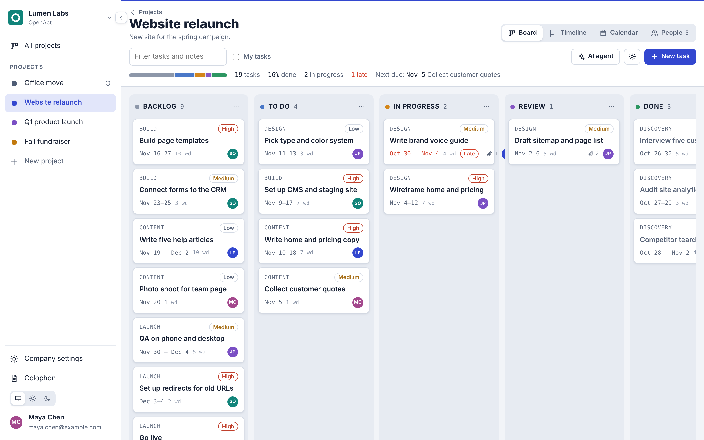
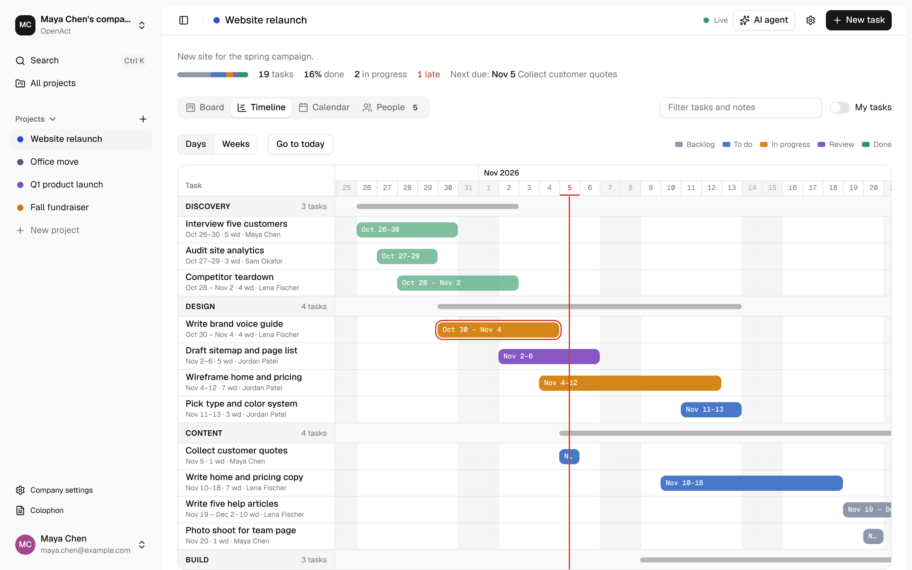
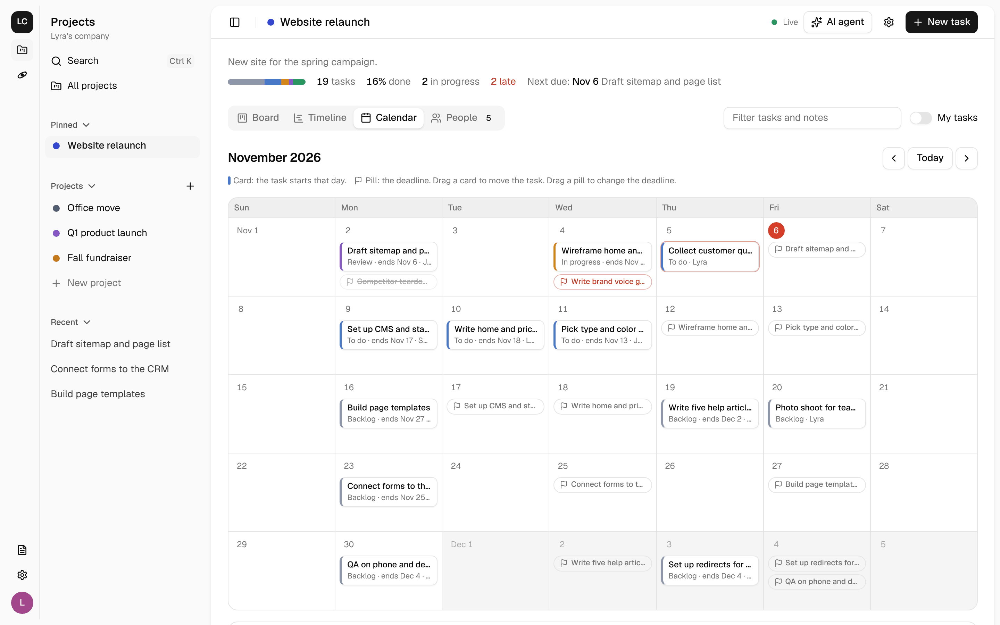
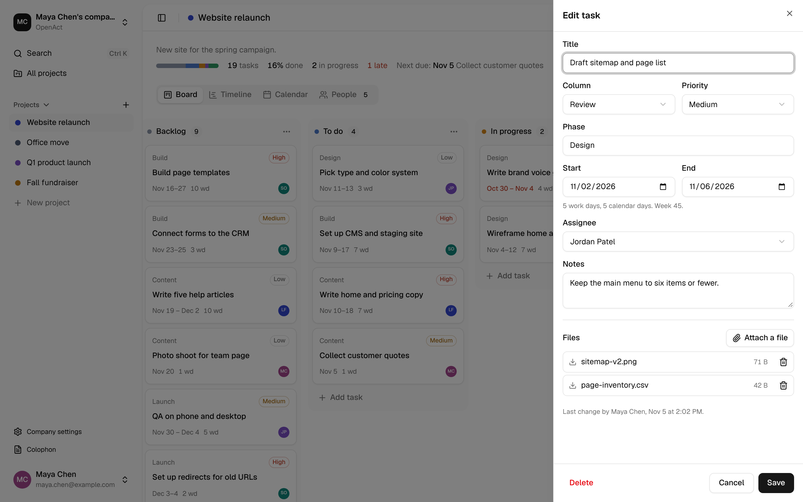
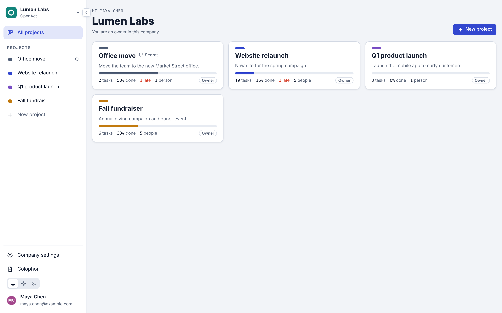
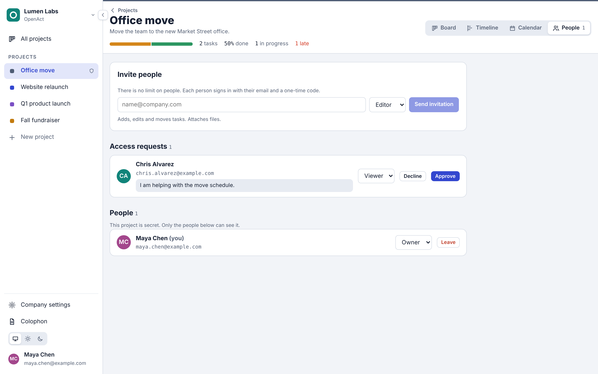
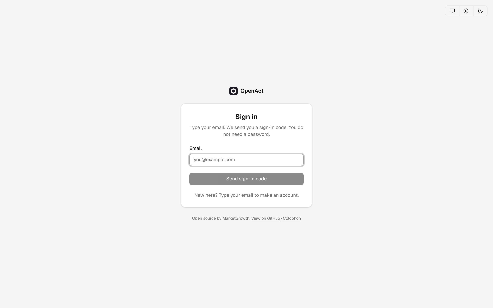
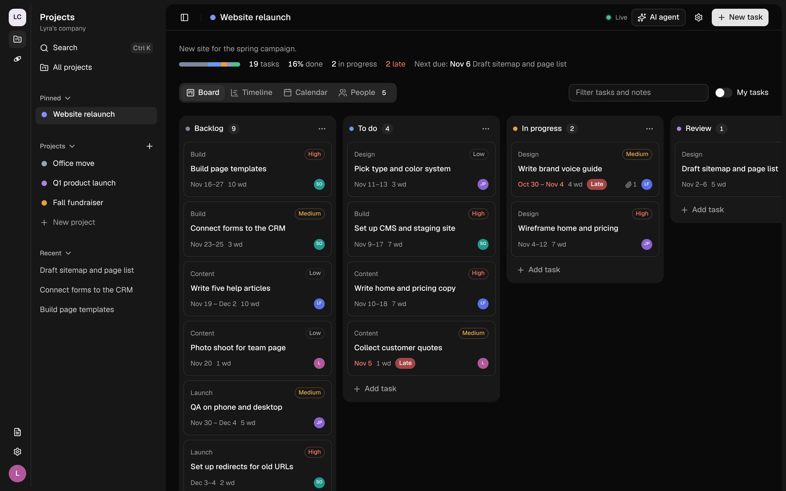
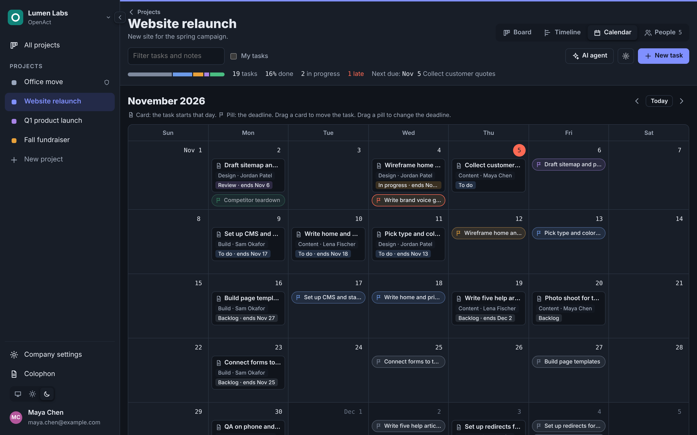
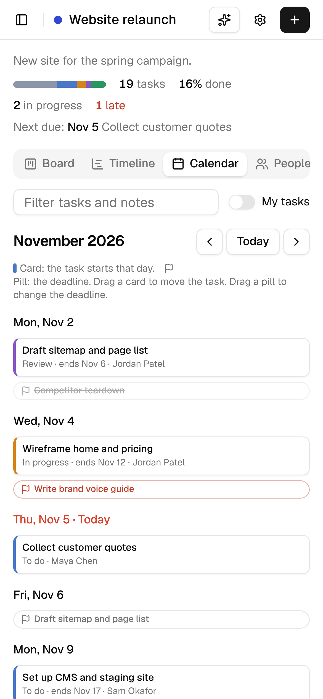

# OpenAct

OpenAct is a light project management tool with a Kanban board, a Gantt timeline and a calendar. It runs on Cloudflare Workers, D1 and R2. MarketGrowth makes it and shares it as open source under the MIT license.

[](https://deploy.workers.cloudflare.com/?url=https://github.com/marketgrowth/openact)



## Features

- **Many projects.** Each project has its own board, timeline, people and files.
- **Unlimited people.** There are no seat limits. Invite anyone by email.
- **Kanban board.** Five columns: Backlog, To do, In progress, Review and Done. Drag cards to change status and order.
- **Gantt timeline.** Drag a bar to move a task. Drag an edge to change its length. Tasks group by phase, with a summary bar for each phase. The header shows days or ISO weeks, and a line marks today.
- **Calendar.** A month view. Each task shows as a card on its start date and as a deadline pill on its end date. Click either to open the task in the side drawer. Drag a card to move the task, or drag a pill to change the deadline. Phones get an agenda list.
- **Roles.** Owners manage people and settings. Editors change tasks. Viewers only look.
- **Sign-in without passwords.** People type their email and get a 6-digit code. [Resend](https://resend.com) sends the email.
- **File attachments.** Attach files up to 25 MB to a task. Files go to R2.
- **AI assist.** Ask questions about the project, draft tasks from a goal, or write a status summary. Requests go through [Cloudflare AI Gateway](https://developers.cloudflare.com/ai-gateway/). Workers AI is the default, so you need no extra API key. Anthropic and OpenAI are optional.
- **Ready for agents.** OpenAct speaks [AG-UI](https://docs.ag-ui.com). The assistant runs on an AG-UI endpoint, and the web app has frontend tools that an agent can call. Read [docs/AGUI.md](docs/AGUI.md).
- **Themes.** Light, dark, or follow the system setting.
- **Stays in sync.** Each open page checks for changes every 5 seconds and reloads the project when someone else edits it.

## Screenshots

The screenshots use example data: a sample team and projects.

| | |
| --- | --- |
|  |  |
| **Timeline.** Drag bars to move tasks. Phases have summary bars. | **Calendar.** Cards show starts. Pills show deadlines. |
|  |  |
| **Task drawer.** Edit details and attach files. | **Projects.** Progress, late tasks and team size at a glance. |
|  |  |
| **People.** Invite by email. Set Owner, Editor or Viewer. | **Sign-in.** An email code. No password. |
|  |  |
| **Dark theme.** Or follow the system setting. | **Dark calendar.** |

<p align="center"></p>
<p align="center"><b>Phones.</b> The calendar becomes an agenda list.</p>

## Deploy with one click

1. Click **Deploy to Cloudflare** above.
2. Sign in to Cloudflare. Connect GitHub or GitLab. Cloudflare copies this repository to your account.
3. Cloudflare creates the D1 database and the R2 bucket for you.
4. Fill in the form:
   - `RESEND_API_KEY`: your [Resend API key](https://resend.com/api-keys).
   - `AUTH_SECRET`: a long random string. Make one with `openssl rand -hex 32`.
   - `EMAIL_FROM`: the sender, for example `OpenAct <no-reply@yourdomain.com>`.
5. Click **Deploy**. The deploy script applies the database migrations, then deploys the Worker.

After the first deploy:

1. In Resend, verify the domain that you use in `EMAIL_FROM`. Without this step, sign-in emails do not arrive.
2. In the Cloudflare dashboard, go to **AI > AI Gateway** and make a gateway named `openact`. If the gateway does not exist, AI requests still work, but without gateway logs and limits.
3. Open your Worker URL. Type your email. The first person can always sign up.

## Deploy by hand

You need Node.js 20 or later and a Cloudflare account.

```sh
git clone https://github.com/marketgrowth/openact.git
cd openact
npm install
npx wrangler login

# Make the database. Copy the database_id from the output into wrangler.jsonc, under d1_databases.
npx wrangler d1 create openact

# Make the file bucket.
npx wrangler r2 bucket create openact-files

# Add the secrets.
npx wrangler secret put RESEND_API_KEY
npx wrangler secret put AUTH_SECRET

# Set EMAIL_FROM and the other settings in wrangler.jsonc under "vars". Then build and deploy.
npm run build
npm run deploy
```

`npm run deploy` applies new migrations first, then deploys. Use it for every update.

## Run it on your computer

```sh
npm install
cp .dev.vars.example .dev.vars   # optional
npm run dev
```

Open http://localhost:8787.

- Without `RESEND_API_KEY`, OpenAct does not send email. It prints each sign-in code in the terminal.
- `npm run dev` runs fully local, so AI assist is off. To use AI on your computer, run `npx wrangler login`, then `npm run dev:ai`.
- For hot reload of the web app, run `npx wrangler dev --local` in one terminal and `npm run dev:ui` in a second terminal. Then open http://localhost:5173.

Other commands:

| Command | What it does |
| --- | --- |
| `npm run typecheck` | Checks the types of the Worker and the web app |
| `npm test` | Runs the unit tests |
| `npm run build` | Builds the web app into `dist/client` |
| `npm run db:migrate:local` | Applies migrations to the local database |
| `npm run db:migrate:remote` | Applies migrations to the Cloudflare database |

## Settings

Set these under `vars` in `wrangler.jsonc`, or in the Cloudflare dashboard.

| Name | Default | What it does |
| --- | --- | --- |
| `APP_NAME` | `OpenAct` | The name in the app and in emails |
| `APP_URL` | empty | The public URL used in email links. Empty means the URL of the request. |
| `EMAIL_FROM` | `OpenAct <no-reply@example.com>` | The sender address. The domain must be verified in Resend. |
| `SIGNUP_MODE` | `open` | `open`: anyone can sign up. `invite`: only invited people can sign up. |
| `ALLOWED_EMAIL_DOMAINS` | empty | A comma-separated list of domains that can sign up, for example `example.com,example.org` |
| `AI_PROVIDER` | `workers-ai` | `workers-ai`, `anthropic` or `openai` |
| `AI_MODEL` | `@cf/meta/llama-3.3-70b-instruct-fp8-fast` | The model ID for the provider |
| `AI_GATEWAY_ID` | `openact` | The AI Gateway name. Empty turns the gateway off. |
| `CF_ACCOUNT_ID` | empty | Your account ID. Needed for `anthropic` and `openai`. |

Set these secrets with `npx wrangler secret put NAME`:

| Secret | Needed | What it does |
| --- | --- | --- |
| `RESEND_API_KEY` | Yes | Sends sign-in codes and invitations |
| `AUTH_SECRET` | Yes | Protects stored sign-in codes. Use 32 or more random characters. |
| `ANTHROPIC_API_KEY` | For `anthropic` | Anthropic API key, sent through AI Gateway |
| `OPENAI_API_KEY` | For `openai` | OpenAI API key, sent through AI Gateway |
| `AI_GATEWAY_TOKEN` | No | Needed only if your AI Gateway uses authentication |

The first person to sign in can always make an account, even in `invite` mode. An invitation always lets that email sign up, even when `ALLOWED_EMAIL_DOMAINS` does not include its domain.

## How sign-in works

1. A person types their email. OpenAct makes a random 6-digit code and sends it with Resend.
2. The code works for 10 minutes and for 5 tries. Only the newest code works.
3. When the code is correct, OpenAct sets a session cookie for 30 days. The cookie is `HttpOnly` and `SameSite=Lax`, and `Secure` on HTTPS.
4. Pending invitations for that email become project memberships.

OpenAct stores only SHA-256 hashes of codes and session tokens. It limits code requests to 5 for each email in 15 minutes and 30 for each IP address in one hour. A daily cron job deletes old codes and sessions.

## How it is built

For the full list of tools, services, fonts and versions, read the [Colophon](docs/COLOPHON.md). The app shows it at `/colophon`.

| Part | Choice |
| --- | --- |
| Runtime | Cloudflare Workers |
| API | [Hono](https://hono.dev) |
| Web app | React and Vite, served as Workers static assets |
| Database | Cloudflare D1, with SQL migrations in `migrations/` |
| Files | Cloudflare R2 |
| Email | Resend REST API |
| AI | Workers AI, Anthropic or OpenAI, through Cloudflare AI Gateway |

```
src/
  shared/types.ts      Types and constants for the API and the web app
  worker/              The API
    index.ts           Routes, security headers, error handling, cron
    auth.ts            Email code sign-in and sessions
    projects.ts        Projects, members and invitations
    tasks.ts           Tasks and file attachments
    ai.ts, plan.ts     AI assist through AI Gateway
    agui.ts            AG-UI endpoint for the project assistant
    email.ts           Resend emails
  shared/agui.ts       AG-UI types, shared agent state and frontend tools
  client/              The web app
    agui/              AG-UI client: SSE parser, event reducer, tool runner
migrations/            D1 schema
test/                  Unit tests
```

Every request that changes a project raises the project's revision number (`rev`). Open pages ask for `rev` every 5 seconds and reload the project when it changes. This keeps the Worker simple and cheap. A Durable Object with WebSockets can replace polling later.

## What AI sees

- **Ask** sends your question, the earlier messages in the conversation, what you see now (view, date, open task, filter) and the task titles, statuses, priorities, phases, dates and assignee names.
- **Draft tasks** sends the goal you type, the start date and the phase names in the project.
- **Status summary** sends task titles, statuses, priorities, phases, dates and the names of assignees.
- AI does not get notes, files or email addresses. Drafted tasks are not saved until you choose them.

## Plans for later

- Live updates with Durable Objects and WebSockets
- Comments on tasks
- Task dependencies on the timeline
- Email notices for assignments and due dates
- CSV import and export

## Contribute

Read [CONTRIBUTING.md](CONTRIBUTING.md). To report a security problem, read [SECURITY.md](SECURITY.md).

## License

MIT. See [LICENSE](LICENSE). Copyright (c) 2026 MarketGrowth.
