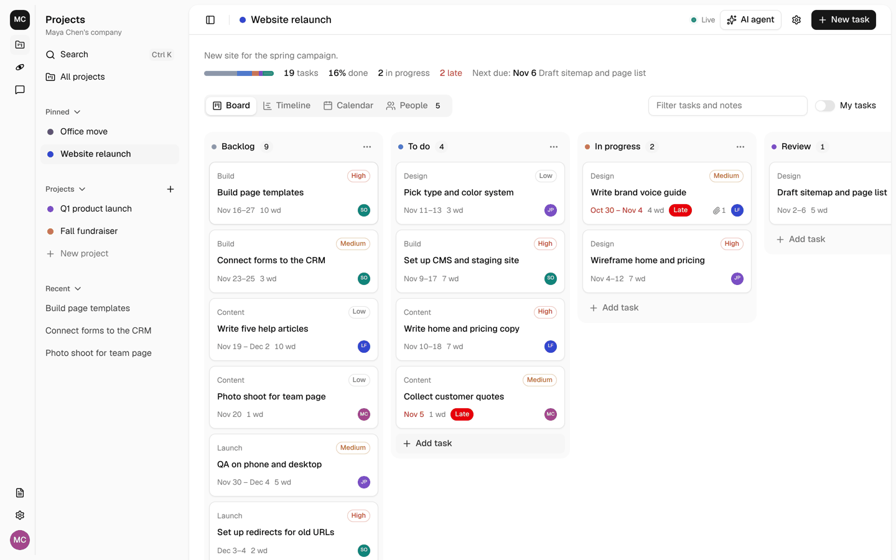

# Building OpenAct apps

OpenAct is a core plus apps. The core gives every app sign-in, people, companies, roles, live updates, email, files and the web shell. An app adds the features. Project management is the first app, and it is installed by default.

## How it fits together

```
packages/core      @openact/core   Sign-in, sessions, companies, roles, live rooms, email, the app system
packages/ui        @openact/ui     The web shell, the side panel, sign-in, company settings, shadcn/ui components
apps/projects      @openact/app-projects   Projects, tasks, board, timeline, calendar, AI agent, task search
apps/<your-app>    Your app
src/               The host: the Worker entry, the web app entry, and this deploy's own pages
openact.apps.json  The installed apps, in order, and the primary app
.openact/          Files that `npm run sync` writes from openact.apps.json. Do not edit them.
```

Cloudflare Workers cannot load new code while they run. So apps are added when you build: `npm run sync` writes a list of the installed apps into `.openact/`, and the build includes them.

## Add an app

```bash
npm run openact -- add contacts                   # an app from the app directory, by its id
npm run openact -- add github:owner/repo          # the default branch
npm run openact -- add github:owner/repo#v1.2.0   # a tag or branch
npm install
npm run deploy                                     # or: npm run dev
```

`add` copies the app into `apps/<id>`, the way shadcn/ui copies components: the code is in your repository, and you can read and change it. It adds the app to `openact.apps.json` and copies its migrations into `.openact/migrations/`. The deploy applies them.

Private repositories work when git on your computer can sign in to GitHub.

| Command | What it does |
| --- | --- |
| `npm run openact -- list` | Shows the installed apps and where they came from |
| `npm run openact -- directory` | Shows the apps in the [app directory](directory.md) |
| `npm run openact -- update <id>` | Copies the app again from GitHub. It replaces `apps/<id>`, so keep your own changes in git. |
| `npm run openact -- remove <id>` | Removes the app. Its tables stay in the database, so you can add it again without data loss. |
| `npm run sync` | Writes `.openact/` again. The build, dev and migrate scripts run it for you. |

## Make an app

An app is a folder with a `package.json` that has an `openact` field:

```json
{
  "name": "@acme/openact-app-inventory",
  "type": "module",
  "openact": {
    "id": "inventory",
    "name": "Inventory",
    "server": "./src/server/index.ts",
    "client": "./src/client/index.tsx",
    "migrations": "./migrations",
    "durableObjects": [],
    "enabledByDefault": true
  },
  "dependencies": { "@openact/core": "^0.2.0", "@openact/ui": "^0.2.0", "hono": "^4.13.16", "react": "^19.3.1" }
}
```

The `id` is 2 to 31 lowercase letters, numbers or dashes. It must be unique in a deploy. Some ids are [reserved](directory.md#reserved-names) for official apps and for OpenAct itself. For a common name, use a longer id, such as `acme-tasks`.

`enabledByDefault` is optional. Set it to `false` when each company must turn the app on first, for example a paid add-on.

### Server side

```ts
// src/server/index.ts
import { Hono } from "hono";
import { defineServerApp, requirePermission, requireUser, type AppEnv } from "@openact/core/server";

const routes = new Hono<AppEnv>();
routes.get("/companies/:id/items", async (c) => {
  const user = requireUser(c);
  await requirePermission(c.env, c.req.param("id"), user.id, "inventory.view");
  const rows = await c.env.DB.prepare("SELECT * FROM inventory_items WHERE company_id = ?").bind(c.req.param("id")).all();
  return c.json({ items: rows.results });
});

export default defineServerApp({
  id: "inventory",
  name: "Inventory",
  permissions: {
    "inventory.view": { label: "See inventory", roles: ["owner", "admin", "member"] },
    "inventory.edit": { label: "Edit items", roles: ["owner", "admin"] }
  },
  routes: (api) => api.route("/api/apps/inventory", routes),
  hooks: {
    companyMemberRemoved: async (env, companyId, userId) => {
      await env.DB.prepare("UPDATE inventory_items SET assigned_to = NULL WHERE company_id = ? AND assigned_to = ?").bind(companyId, userId).run();
    }
  }
});
```

| Part | What it is for |
| --- | --- |
| `permissions` | What people can do in your app, by company role. See [Permissions](permissions.md). |
| `routes` | Your API. Use `/api/apps/<id>/...`. The projects app keeps its older paths. |
| `middleware` | Runs on every API request after the session is read |
| `scheduled` | Runs on each cron trigger |
| `hooks.allowSignup` | Lets an email sign up when sign-up is limited, for example because of your app's invitation |
| `hooks.signedIn` | Runs after each sign-in, for example to accept your app's invitations |
| `hooks.companyMemberRemoved` | Remove the person's access to your data in that company |
| `hooks.companyDeleting` | Delete your data and files for that company |
| `hooks.companyCreated` | Set up a new company |
| `hooks.companyDetail`, `hooks.companyUpdate` | Read and save your app's company settings through `/api/companies/:id` |

### Permissions

Declare what people can do in your app in `permissions`, and check it with `requirePermission()` in every route. The core stores each company's choices, and Company settings shows them. Read [Permissions](permissions.md) for the full guide.

Apps that a super admin turns off in Site settings are off in every company. `requirePermission`, `requireAppOn` and `companyAppState` already count that switch. Routes outside `/api/`, such as a public link, must call `loadSite(env)` first, because only `/api/` routes load the site settings for you.

Live updates: call `registerRoomKind("inventory-item", readRevisions)` once, `markChanged("inventory-item", id)` when data changes, and `acceptLive()` in a route that checks access first. Pages use `useLive()` from `@openact/ui`.

### Client side

```tsx
// src/client/index.tsx
import { lazy } from "react";
import { defineClientApp } from "@openact/ui";

const InventoryPage = lazy(() => import("./InventoryPage"));

export default defineClientApp({
  id: "inventory",
  name: "Inventory",
  icon: "box",
  routes: [{ pattern: /^\/a\/inventory\/?$/, render: () => <InventoryPage /> }]
});
```

### The app rail and the app panel

The side panel has two columns, like a desktop chat app:

- **The app rail** on the left. It shows the company, one icon for each app, the App directory, the footer items, Company settings and the person's menu. Projects is first, because it is installed first.
- **The app panel** beside it. It shows the active app's name, its commands, its `nav` items and its `SidebarSection`. The projects app shows Pinned, Projects and Recent here.

Ctrl+B or Cmd+B collapses the panel and leaves only the rail. On a phone, both columns open as one sheet.



### The primary app

A deploy can have one primary app. Use it for the app that the deploy is for, such as a company's own app. The primary app goes at the top of the rail, above a divider. The other apps go below it, in install order. Another divider separates them from the App directory.

| Primary app | The rail, from the top |
| --- | --- |
| None | Projects, Docs, divider, App directory |
| `gtmmatters` | GTM Matters, divider, Projects, Docs, divider, App directory |

Set it with the app tool. The command writes `"primary"` in `openact.apps.json`:

```bash
npm run openact -- primary gtmmatters
npm run deploy
```

Run `npm run openact -- primary none` to remove it. `npm run sync` fails when `"primary"` names an app that is not installed or that has no web code. The rail shows the primary app only when it has an `icon` or a `Mark` and the company has it on. If not, the rail shows the other apps as if there is no primary app. On the Apps page, the primary app is first and has a **Primary** badge.

The primary app does not change which app owns `/`. The first app with a home page still owns it.

An app shows in the rail when it has an `icon` or a `Mark`. Its pages live under `/a/<id>/` by default, and the rail lights the app that owns the current page. See `examples/orbytt` for a second app with its own icon, panel and pages.

| Part | What it is for |
| --- | --- |
| `icon` | The app's icon in the rail, as a Lucide name for `Icon`, such as `"users"` |
| `Mark` | A custom rail icon, such as a brand mark. Draw it with `currentColor`. |
| `home` | Where the rail icon goes. Default: `/` for the first app with a home page, otherwise `/a/<id>` |
| `ownsPath` | Says which paths belong to the app. Default: the home, `/a/<id>/...` and the app's routes |
| `routes` | Pages. Start each one with `SiteHeader` and put its content in `PageBody`. |
| `Home` | The page at `/`. The first app with a home page owns it. |
| `nav` | Items at the top of the app's panel (`main`), or icons at the bottom of the rail for every app (`footer`) |
| `SidebarSection` | Groups in the app's panel, such as Pinned, Projects and Recent |
| `commands` | Dialogs that open from the app's panel (`inSidebar`), a shortcut such as Ctrl+K, or `useShell().runCommand(id)` |
| `companySettingsTabs` | Tabs in Company settings |
| `Provider` | State for your app around the whole shell |
| `publicRoutes` | Pages that work without sign-in |

Use `useShell()` for the person and the config, `useWorkspace()` for the current company, and the shadcn/ui components at `@openact/ui/components/<name>`. Load pages with `lazy()`, so new apps do not slow the first page.

### Migrations

Put numbered SQL files in `migrations/`, such as `0001_init.sql`. `npm run sync` copies them as `<id>_0001_init.sql`. Wrangler applies new files in name order, after the core's files. Your tables may use core tables, such as `users` and `companies`. Core tables never use yours.

## Rules for apps

1. **Prefix everything with your id.** Tables (`inventory_items`), routes (`/api/apps/inventory`), R2 keys (`inventory/...`), room kinds and command ids. The projects app made some tables before apps had prefixes: `projects`, `project_members`, `tasks`, `attachments`, `board_columns`, `invitations`, `agent_actions`, `access_requests` and `vector_outbox`. Never use these names.
2. **Scope your data to a company.** Every row has a `company_id`. Check access with `requirePermission`, or your own item check built on it.
3. **Use the core for people.** Never read or write `users`, `sessions`, `companies` or `company_members` directly, except for read-only joins. Never handle sign-in yourself.
4. **Follow the UI rules** in AGENTS.md: shadcn/ui components, Tailwind token classes, Lucide icons, `SiteHeader` and `PageBody`.
5. **Clean up through hooks.** When a person leaves a company, or a company is deleted, your hooks remove their access and data.
