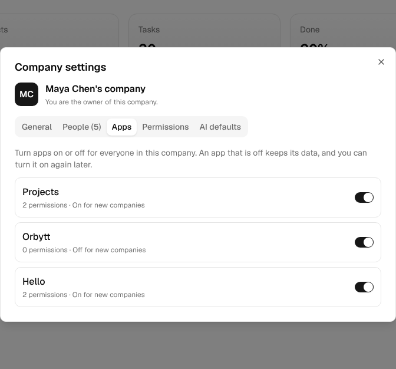
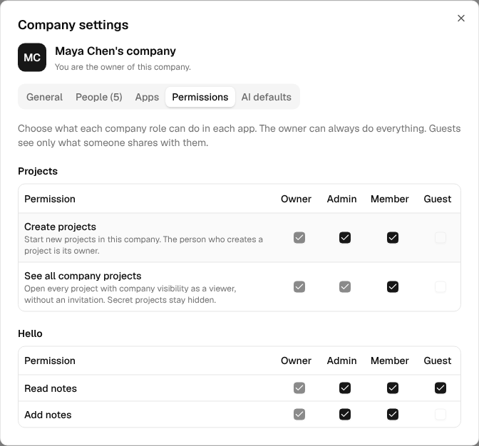

# Permissions

An app says what people can do in it. The OpenAct core stores each company's choices and checks them on every request. An app builder does not write a settings screen or a role table.

This page uses a sample app named **Tasks** to show each step.

## How it works

The core owns people, companies and company roles. An app owns its own data. Permissions connect the two:

1. **The app declares its permissions.** Each one has an id, a label, and the company roles that have it by default.
2. **Company owners and admins choose.** In **Company settings**, they turn apps on or off and change which roles have each permission.
3. **The app checks every request.** One call, `requirePermission()`, checks the company, the app switch and the role.
4. **The web app follows.** `useCan()` hides or turns off buttons that the person cannot use.

```
Tasks app          declares tasks.create, tasks.delete, ...
    |
OpenAct core       keeps each company's choices in the company_apps table
    |
Company settings   Apps tab: on or off.  Permissions tab: a box for each role
    |
Every request      requirePermission() -> 404, 403 app_off, 403 no_permission or OK
```

## Company roles

Every person in a company has one company role. Permissions use these roles.

| Role | Who it is for |
| --- | --- |
| Owner | The people who own the company. They always have every permission. |
| Admin | People who manage the company and its people |
| Member | People who work in the company |
| Guest | People from outside the company. They see only what someone shares with them. |

## 1. Declare the permissions

List the permissions in `defineServerApp()`. Each id starts with your app id and a dot.

```ts
// apps/tasks/src/server/index.ts
import { defineServerApp } from "@openact/core/server";
import { routes } from "./routes";

export default defineServerApp({
  id: "tasks",
  name: "Tasks",
  permissions: {
    "tasks.view": {
      label: "See tasks",
      description: "See the company task list.",
      roles: ["owner", "admin", "member"]
    },
    "tasks.create": {
      label: "Create tasks",
      roles: ["owner", "admin", "member"]
    },
    "tasks.delete": {
      label: "Delete tasks",
      description: "Delete any task, also tasks that other people made.",
      roles: ["owner", "admin"],
      locked: ["owner", "admin"]
    },
    "tasks.comment": {
      label: "Comment on shared tasks",
      roles: ["owner", "admin", "member", "guest"],
      guests: true
    }
  },
  routes: (api) => api.route("/api/apps/tasks", routes)
});
```

| Field | Required | What it does |
| --- | --- | --- |
| `label` | Yes | A short name for Company settings. Start with a verb, such as "Create tasks". |
| `description` | No | One sentence that says what the permission allows |
| `roles` | Yes | The roles that have the permission when the company has not changed it |
| `locked` | No | Roles that always have the permission. Nobody can turn them off. |
| `guests` | No | `true` when guests may get the permission. The default is `false`. |

The core checks the declarations when the Worker starts. It stops with a clear error when an id does not start with the app id, when a role does not exist, or when `roles` includes `guest` without `guests: true`.

## 2. Check on the server

Call `requirePermission()` at the start of every route that reads or changes company data.

```ts
// apps/tasks/src/server/routes.ts
import { Hono } from "hono";
import { newId, nowIso, readJson, requirePermission, requireUser, text, type AppEnv } from "@openact/core/server";

export const routes = new Hono<AppEnv>();

routes.post("/companies/:id/tasks", async (c) => {
  const user = requireUser(c);
  const companyId = c.req.param("id");
  await requirePermission(c.env, companyId, user.id, "tasks.create");

  const title = text((await readJson(c)).title, "Title", { max: 200, required: true });
  const id = newId();
  await c.env.DB.prepare("INSERT INTO tasks_items (id, company_id, title, created_by, created_at) VALUES (?, ?, ?, ?, ?)")
    .bind(id, companyId, title, user.id, nowIso())
    .run();
  return c.json({ id }, 201);
});
```

`requirePermission(env, companyId, userId, permission)` checks these things in order:

| Check | When it fails | Response |
| --- | --- | --- |
| The person is in the company | They are not in it, or the company does not exist | 404 |
| The app is on in the company | An owner or admin turned it off | 403, code `app_off` |
| The person's role has the permission | The company did not give it to their role | 403, code `no_permission` |

When every check passes, it returns the person's company role. The error messages tell the person what to do next, for example: "Your role in this company does not allow this: Create tasks. Ask a company owner or admin to change it in Company settings."

Other helpers from `@openact/core/server`:

| Helper | What it does |
| --- | --- |
| `hasPermission(env, companyId, userId, permission)` | The same check, as `true` or `false`. It never throws for a missing company or an app that is off. |
| `requireAppOn(env, companyId, appId)` | Throws 403 `app_off` when the app is off |
| `companyAppState(env, companyId)` | Reads every switch and permission for one company in one query. It returns `enabled(appId)` and `roles(permission)`. |
| `appOffError(appId)` | The `app_off` error, for your own access checks |

## 3. Check in the web app

`useCan()` is `true` when the person has the permission in the current company. Use it to hide or turn off buttons.

```tsx
import { useCan } from "@openact/ui";
import { Button } from "@openact/ui/components/button";

export function NewTaskButton({ onClick }: { onClick: () => void }) {
  const canCreate = useCan("tasks.create");
  if (!canCreate) return null;
  return <Button onClick={onClick}>New task</Button>;
}
```

| Hook | What it returns |
| --- | --- |
| `useCan(permission)` | `true` when the person has the permission in the current company |
| `useAppOn(appId)` | `true` when the app is on in the current company. Apps count as on while the access loads. |
| `useWorkspace().access` | The full answer: the person's role, the apps that are off, and their permissions |

`useCan()` only changes what the person sees. Always check the permission on the server too.

## 4. Owners and admins choose

Company settings has two tabs for apps. OpenAct builds both from the declarations, so your app needs no settings code.

**Apps.** A switch for each installed app. An app that is off leaves the app rail, its commands and its pages for everyone in the company. Its data stays, so the company can turn it on again later. A company must keep at least one app on.



**Permissions.** A table for each app, with a row for each permission and a box for each role. Boxes for the owner, for locked roles, and for guests on permissions without `guests: true` cannot change.



A change takes effect on the next request. The person who made it sees the new rail and buttons at once.

## Rules that never change

- **The owner always has every permission.** A company can never lock itself out.
- **Locked roles keep the permission.** Use `locked` for roles that manage everything. The projects app locks "See all company projects" for owners and admins, because they manage every company project.
- **Guests get a permission only with `guests: true`.** Guests come from outside the company and see only what someone shares with them. Set `guests: true` only for actions that are safe for them, such as a comment on a task that someone shared.
- **The app's data stays in its company.** Every row has a `company_id`. `requirePermission()` checks the company in the URL, so also check that each row you read belongs to that company.

## Apps that start off

Set `"enabledByDefault": false` in the app's `package.json` when each company must turn the app on first, for example a paid add-on.

```json
{
  "openact": {
    "id": "tasks",
    "name": "Tasks",
    "server": "./src/server/index.ts",
    "client": "./src/client/index.tsx",
    "enabledByDefault": false
  }
}
```

The app is installed in the deploy, but it shows for a company only after an owner or admin turns it on in the Apps tab.

## Access to one item

Permissions answer "what can a member do in Tasks?" They do not answer "who can see this one private list?" Access to one item stays in your app. Combine your item check with the company permission.

The projects app shows the pattern. Its `requireRole()` reads the project role, the company role, the project's visibility, and the company's choice for `projects.browse`:

| The person | Their access to a project with company visibility |
| --- | --- |
| On the project | Their project role |
| Company owner or admin | Owner |
| Member, with "See all company projects" | Viewer |
| Member, without "See all company projects" | None, until someone adds them |
| Guest | None, until someone adds them |

Secret projects ignore company roles. Only the people on the project see them.

## The Projects app's permissions

| Permission | Label | Default roles | Locked |
| --- | --- | --- | --- |
| `projects.create` | Create projects | Owner, Admin, Member | Owner |
| `projects.browse` | See all company projects | Owner, Admin, Member | Owner, Admin |

Project roles (owner, editor and viewer) still control what a person can do inside a project.

## API

The web app uses these routes. Your app does not need to call them.

| Route | Who | What it does |
| --- | --- | --- |
| `GET /api/companies/:id/access` | Anyone in the company | The person's role, the apps that are off, and their permissions |
| `GET /api/companies/:id/apps` | Owners and admins | Every installed app with its switch and permissions |
| `PATCH /api/companies/:id/apps/:appId` | Owners and admins | Body: `{ "enabled": true }` or `{ "permissions": { "tasks.create": ["admin", "member"] } }` |

```json
// GET /api/companies/c_123/access
{
  "role": "member",
  "disabledApps": ["orbytt"],
  "permissions": ["projects.create", "projects.browse", "tasks.view", "tasks.create"]
}
```

## Questions

**Where are the choices stored?** In the core table `company_apps`. A company has a row for an app only after it changes something. Without a row, the app's defaults apply. So a new permission in an app update works at once, with its default roles.

**What happens when I rename or remove a permission?** A company's choice for the old id stays in the table, but nothing reads it. Keep ids stable. Add a new id when the meaning changes.

**Can two apps share a permission?** No. Each permission belongs to the app whose id starts it. Another app can call `hasPermission()` to read it.

**Does the AI agent follow permissions?** The projects agent acts with the person's project role and never does more than the person can. Apps that add agent tools must call `requirePermission()` in those tools too.
